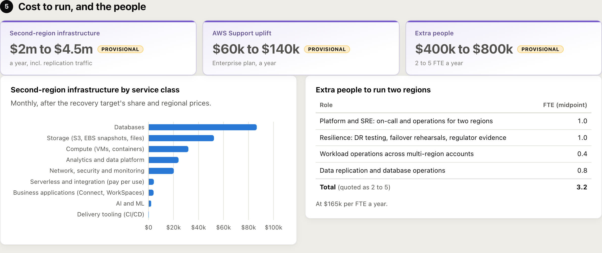
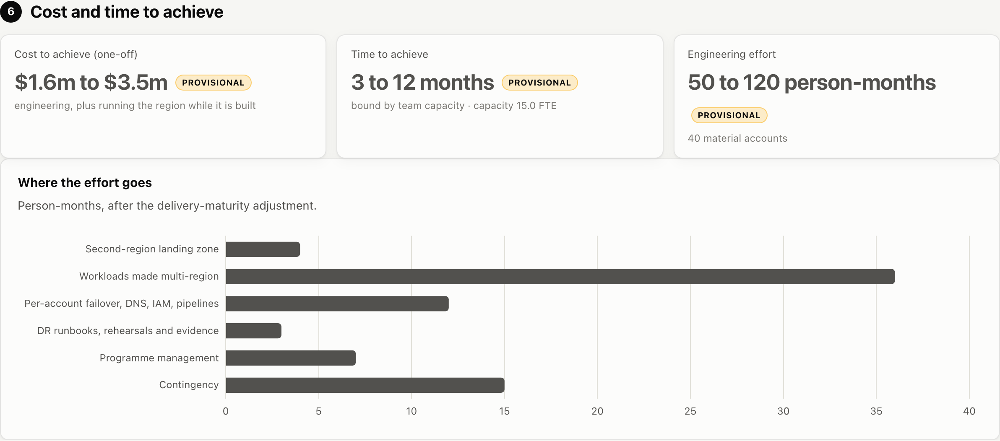

# Multi-region: the cost of a second AWS region

The **Multi-region** tab answers the question a regulator asks once the exit plan is in place:
*what would it take to survive the loss of a whole AWS region?* It uses the same scan as the exit
report, so there is nothing new to collect and no new permission (Cost Explorer's `REGION`
grouping is covered by `ce:GetCostAndUsage`).

It gives, for the accounts you choose:

- **Extra cost to run** a year: second-region infrastructure, replication traffic, the AWS Support
  uplift and the extra people.
- **Cost and time to achieve**: engineering effort, plus running the region while it is built.
- **Extra staff** (FTE) and what they do.
- **A recommended second region**, from service parity, latency and price.
- **Per-account failover risks**: for every service in each account, whether it fails over by
  itself, needs manual or scripted failover (EC2, most databases), must be restored or re-run
  (Redshift, Glue, EMR), or is not offered in the second region at all.

Every figure is an approximate range and stays **provisional** until the questions in section 2
are confirmed.


## The choices (section 2)

| Choice | Options | Effect |
|---|---|---|
| Recovery target | **Recover within 3 hours** (systemic risk event; pilot light) or **On demand: instant** (active-active) | The share of each service class run in the second region, the build effort, the staff, and how risky each service is |
| Where may the second region be? | Anywhere, same continent, same jurisdiction, same country | Filters candidate regions (data residency) |
| Primary region | Detected from spend, or set | Where latency and prices are measured from |
| Second region | Recommended, or any region | The region costed |
| AWS Support plan | Enterprise, Enterprise On-Ramp, Business, none | Support is a percentage of usage, so a second region raises it |
| Team, day rate, CI/CD, Terraform | Shared with the exit estimate | Build effort and capacity |
| Cost per extra FTE | 0 = day rate × 220 days | Staff cost |

## Accounts (section 3)

All in-scope accounts, **sorted by spend**, ticked by default. *Select all*, *Select none* and
*Top 10 by spend* help; the choice is remembered per scan. **Readiness** is the worst failover risk
among an account's material services for the chosen target; open the row for each service's risk
and what has to be done, for example:

> **EC2** · Manual failover: EC2 has no cross-region failover. AMIs, launch templates and capacity
> reservations must exist in the second region, and instances are started by a runbook or
> automation.

| Severity | 3-hour recovery | Instant |
|---|---|---|
| Low | AWS replicates and fails over (S3 CRR, DynamoDB global tables, Aurora Global Database) | same |
| Moderate | Manual or scripted failover (EC2, RDS replicas, ECS, Lambda) | High |
| High | No live replica: restore or re-run (Redshift, Glue, EMR, Athena) | Critical |
| Critical | Not offered in the second region: re-architect | Critical |

Some notes depend on the second region. DynamoDB import from S3 takes up to 15 TB of source data at a
time in us-east-1, us-west-2 and eu-west-1 but only 1 TB in every other region ([DynamoDB service
quotas](https://docs.aws.amazon.com/amazondynamodb/latest/developerguide/ServiceQuotas.html#import-limits)),
so rebuilding a large table from an S3 export in, say, Frankfurt or Cape Town has to be batched. Export to
S3 has the same limit everywhere (100 TB in flight), and a new global table replica backfills up to 10 TB
per region per day. Region-specific notes live under `quota` in `risks` in `regions.yaml`.


## Which second region (section 4)

Every region that passes the residency rule is scored 0 to 100:

- **Service parity**: the share of the chosen accounts' regional spend on services offered in the
  candidate, from the AWS regional services list (`data/region_services.json`, refreshed with
  `scripts/refresh_region_services.py`). A missing service needs re-architecture, so parity is
  penalised steeply (raised to the 6th power).
- **Latency**: estimated round trip from the primary, by great-circle distance at fibre speed with
  a routing overhead. Regions without a direct path (Cape Town) are routed via their hub.
- **Price**: a regional price index against the primary.

Weights: 3-hour recovery 55% parity / 20% latency / 25% price; instant 45% / 45% / 10%, because
active-active needs low latency. A region where at least 5% of spend already runs is noted, and its
landing-zone effort is halved.

Each candidate says **why it ranks where it does** against the best one: the services it lacks and
what they cost a month, how much further it is, how much dearer, or, for a near tie, what differs
either way. The summary names the two runners-up with the same reasons.

**Corrections.** Click a service under "Not available" to correct it:

- *Available in this region*: the AWS list lags launches, or a service is offered under another
  name. The correction applies to that region only.
- *Not needed in the second region*: a service that will not be replicated (for example a contact
  centre with its own resilience, or a tool you will drop). It leaves parity, run cost and effort
  for every region, and is listed under "Your corrections" with its spend.

Example: a Cape Town primary using Amazon Connect gets Frankfurt or London, because Connect is not
offered in Ireland. Mark Connect as not needed and Ireland, a little cheaper at similar latency,
comes first.

**Regulation to check.** For the primary region's jurisdiction, the page lists the rules a move
of data to the chosen second region touches: South Africa (POPIA section 72; Prudential Authority
Directive 3 of 2018 and Guidance Note 5 of 2018; Joint Standards 1 of 2023 and 2 of 2024), the EU
(GDPR Chapter V, DORA), the UK (UK GDPR transfers, PRA SS2/21), and a general note elsewhere.
Cross-border items show only when the second region is in another country; regulator items only
when the organisation is regulated (section 2 of Exit model). They are pointers for the
compliance conversation, not legal advice; edit `regulation` in `data/regions.yaml` to add yours.


## Cost to run (section 5)

Each service's regional spend is placed in a class (in `data/regions.yaml`) with the share of it
that runs in the second region, per recovery target:

| Class | 3-hour recovery | Instant | Why |
|---|---|---|---|
| Compute | 12% | 100% | Pilot light: a small footprint scaled up on failover |
| Databases | 45% | 100% | A replica runs all the time |
| Storage | 80% | 100% | Replicated copies are stored in full |
| Analytics | 25% | 100% | Data copied; compute only on failover |
| Network, security, monitoring | 40% | 100% | Regional and always on |
| Serverless and integration | 5% | 35% | Pay per use: cost follows traffic |
| Business applications | 15% | 100% | Connect, WorkSpaces |
| AI and ML | 5% | 50% | |
| Delivery tooling | 5% | 20% | |
| Global (IAM, Route 53, CloudFront) | 0% | 0% | One copy serves every region |

Then: × the candidate's price against the source region; **replication traffic** adds 6% (3 hours)
or 20% (instant) of data, storage and analytics spend; **AWS Support** is recalculated on the larger
bill at list price (Enterprise: 10% to $150k, 7% to $500k, 5% to $1m, 3% above; minimum $15k).

**People.** Extra FTE = 10% (3 hours) or 35% (instant) of the core cloud team for on-call and
two-of-everything operations, plus 1.0 or 2.5 for DR testing and regulator evidence, plus 0.25 or 1.0
per 25 material accounts, plus 0.5 or 1.5 for replication and database operations (scaled by
√(database spend / $100k a month), at most 3×). At least 1.5 or 4 FTE.



## Cost and time to achieve (section 6)

Bottom-up, like the exit estimate:

- **Per service**: the class's engineer-weeks (e.g. databases 0.75 for 3 hours, 2.5 for instant) ×
  √(monthly spend / $1k). A service missing in the second region adds its full exit effort from the
  catalog (re-architect); one whose availability cannot be verified gets +25%.
- **Per material account**: 1 or 2 weeks for DNS failover, IAM and pipelines to two regions.
- **Second-region landing zone**: 8 or 14 weeks plus 0.25 per account (halved if the region is
  already in use).
- **DR programme**: 4 or 8 weeks plus 0.2 per account (runbooks, rehearsals, evidence).
- × the delivery factor (CI/CD × Terraform × regulated), + 12% programme management, + contingency.
- **Duration** = effort ÷ (team × allocation + application engineers) × 80% productive time, never
  less than the critical path (20 or 39 weeks), plus 4 weeks of failover rehearsal.
- **Cost** = effort × day rate + half the second region's run cost for the build period.
- **Ranges**: cost −25% / +50%, time −20% / +40%, staff ×0.75 / ×1.4.



## Data

- Scans from v0.3.0 collect spend by region. Older scans have no region split: the view assumes all
  regional spend is in the primary region and says so. Re-scan for the real split.
- The demo estate runs production 90% in London (eu-west-2) and 10% in Ireland.

## When something is wrong

- **Data notes** at the top of the view say what the estimate had to assume, and are logged once per
  scan: no spend-by-region data (older scan, or Cost Explorer refused it), an unknown primary region
  (choose it in section 2), spend in a region this version does not know, services with no
  multi-region profile, a second region that cannot be used, or an AWS regional services list more
  than 180 days old.
- **A failed calculation** shows a panel in place with the error, the request id and **Try again** /
  **Open the log**, never a blank tab. A failed PDF export exits non-zero with the reason.
- **Check access** proves the region data is readable with the same Cost Explorer call it already
  makes (grouped by account and region), at no extra cost.
- **A failure reading spend by region** never fails the scan: it becomes a warning on the Data quality
  section; an unexpected (non-AWS) error is also logged with its traceback.
- Every calculation logs one line: scan, recovery target, accounts chosen, primary and second
  region, run cost, build weeks and time taken.

## CLI

```bash
exitrisk report --scan <id> --view multiregion --multiregion answers.json --out mr.json
exitrisk pdf    --scan <id> --view multiregion --multiregion answers.json --out mr.pdf
```

`answers.json` (all optional):

```json
{"recovery": "instant", "residency": "same_continent", "secondary": "eu-central-1",
 "support_plan": "enterprise", "accounts": ["123456789012"], "confirmed": true}
```

## Limitations

- Coefficients are planning assumptions, not quotes. They are all in `data/regions.yaml` and listed
  under *Assumptions* on the page: challenge them.
- Latency is estimated from geography, not measured. Measure before committing.
- Service availability is per service, not per feature or instance type.
- Enterprise Discount Programmes, Savings Plans and Reserved Instances are not modelled.

Sample: [sample-multiregion.pdf](sample-multiregion.pdf).
